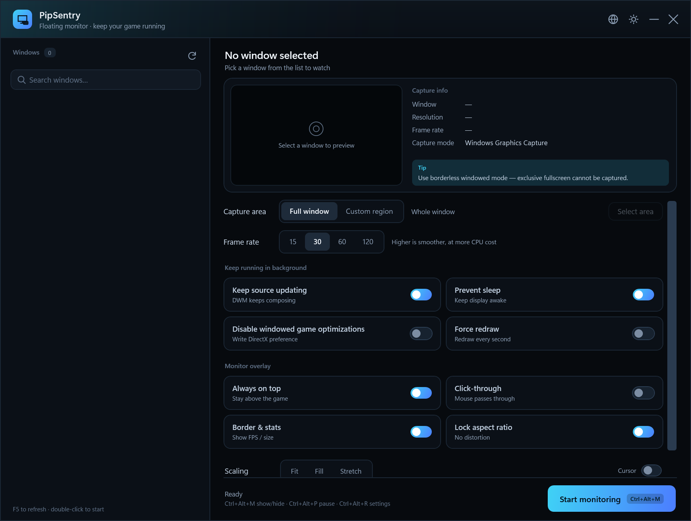

# PipSentry

A small window monitor for Windows. It pins one part of a window (or screen) on top, so you do not have to switch back to check progress.



## What it does

- Captures background windows. The source is still captured while other windows cover it (Windows Graphics Capture).
- Captures one small part of the frame only. The region is rescaled automatically after a resolution change.
- The overlay is frameless and always on top. Opacity, click-through, corner snap and size presets are adjustable.
- Dark and light themes. Traditional Chinese, Simplified Chinese and English.
- Portable single-file exe, or an MSI install.

## Requirements

Windows 10 2004 (build 19041) or later, Windows 11, x64. No separate .NET install is needed.

## Usage

1. Open the app and pick the window you want from the list on the left.
2. To capture one part only, switch to "Custom region", press "Select region", drag an area and press Enter.
3. Press "Start monitoring".

Move the mouse over the overlay and a toolbar appears. Right-click for snap, size, click-through and screenshot.

## Hotkeys

| Key | Action |
| --- | --- |
| `Ctrl+Alt+M` | Show / hide the monitor window |
| `Ctrl+Alt+P` | Pause / resume |
| `Ctrl+Alt+S` | Screenshot (saved to `Pictures\PipSentry`) |
| `Ctrl+Alt+R` | Back to settings |
| `Ctrl+Alt+T` | Click-through |
| `F5` | Refresh the window list |

Settings live in `%LOCALAPPDATA%\PipSentry\settings.json`.

## Limitations

- Exclusive fullscreen cannot be captured. The game writes straight to the display and bypasses DWM, which is where the capture reads from. Use borderless windowed mode, or turn off "fullscreen optimizations" for the game exe.
- Some games set `WDA_EXCLUDEFROMCAPTURE`. The frame stays black even in borderless mode. The app reports this once, it does not try to work around it.
- Minimized windows cannot be captured.
- Some programs draw into their own child windows (some Android emulators, for example). Those come out black.
- To capture a window that needs administrator rights, PipSentry must run with the same rights.

## Keeping the game alive

A game switched to the background while idle is often throttled or stops updating. The app provides four switches:

- Keep the source updating: keep DWM composing the source window while monitoring.
- Prevent system sleep: `SetThreadExecutionState`.
- Disable windowed game optimizations: write `SwapEffectUpgradeEnable=0` for the target exe. Restart the game after the change.
- Force the target to redraw: send `RedrawWindow` once per second. Useful for older windows.

## Performance

Test machine: Windows 11 x64, 3840×2160 (150% scale), 32 threads. Every number comes from the built-in `--bench` (10 seconds per scenario). Each value is the stable one of three runs.

| Scenario | Before | After |
| --- | --- | --- |
| Full window 4K @30 | 23.6 fps / 745 MB/s / 17.0% of one core | 26.0 fps / 17.5 MB/s / 8.9% of one core |
| Full window 4K @60 | 51.7 fps / 1,637 MB/s / 28.4% of one core | 51.9 fps / 35.0 MB/s / 13.1% of one core |
| Region 640×360 @60 | 51.6 fps / 45.4 MB/s / 11.6% of one core | 51.9 fps / 34.9 MB/s / 4.4% of one core |
| Preview (4K window) | 550 MB/s / 13.1% of one core (20 fps, full size) | 5.2 MB/s / 3.1% of one core (15 fps, 429×252) |
| Overlay hidden | 5.5% of one core (still capturing in the background) | 0 MB/s, about 1–2% of one core (capture stopped) |
| Start until the window appears | 611–673 ms | 614–671 ms |

- MB/s is the number of pixels moved from GPU back to CPU per frame. `--bench` counts it directly.
- GPU: `GPU Engine(*)` counters. The 3D engine drops from about 6.7% to 0.47%.
- Memory: working set is about 123–125 MB after 10 seconds of capture. Under the same load for 120 seconds it stays at 125 MB (no growth).
- The "before" preview figure stands in for 20 fps full-size capture (older versions had no output cap).

### What changed

1. Read back only the display size: the overlay and the preview each report their real pixel size, and the capture engine scales to that size with Direct2D on the GPU before reading back. A full 4K window goes from 33 MB per frame to 0.7 MB.
2. Preview runs at 15 fps (was 20) and uses the same scaling.
3. Preview capture stops while the main window is hidden or minimized, and starts again through `ShowShell` when it returns to the foreground.
4. While the overlay is hidden, frame delivery and the stats timer stop. The session stays alive (DWM keeps composing), but nothing is copied.
5. Fixed an i18n resource key clash: `Live` was both a theme color and a string, which made the LIVE label throw and kept firing error notifications.

### Trade-offs and assumptions

- Scaling uses GPU linear sampling. At 4K scaled down to 560, text edges are slightly softer than native. For raw pixels, enlarge the overlay or use region mode.
- The capture cap follows the overlay's physical pixels. When the window is larger than the cap, WPF scales it again, so there can be a second scaling pass.
- If D2D creation fails (old drivers, WARP), the app falls back to the original full-size read-back. Same features, just slower.
- A full 4K window at @60 is still about 52 fps. That is the WGC frame pacing plus the WPF upload limit. The architecture was not changed for this.
- With "keep the source updating" on, the session is not closed in the background, frames are just not delivered. So the hidden state still shows 1–2% CPU.

### Measuring it yourself

```powershell
# 10 seconds, full 4K window, cap 560x315 (simulates a small overlay)
PipSentry.exe --bench report.txt --fps 60 --scale 560x315

# Region mode
PipSentry.exe --bench report.txt --fps 60 --scale 560x315 --region 1200,600,640,360

# Paused state (simulates hidden)
PipSentry.exe --bench report.txt --fps 60 --paused

# Grab one frame after the cap, to check scaling quality
PipSentry.exe --grab out.png --scale 560x315 --region 1200,600,960,540
```

## Build

```powershell
./build.ps1
```

Needs the .NET 8 SDK. Building the MSI also needs WiX 5. Output goes to `dist/`.

## Screenshots

| File | What it shows |
| --- | --- |
| `docs/screenshot-dark-en.png` | Dark theme, English UI |
| `docs/screenshot-dark-zh-hant.png` | Dark theme, Traditional Chinese UI |
| `docs/screenshot-light-en.png` | Light theme, English UI |

## License

MIT. The design looked at how OnTopReplica, WindowTop and OBS do things. None of their code is used.