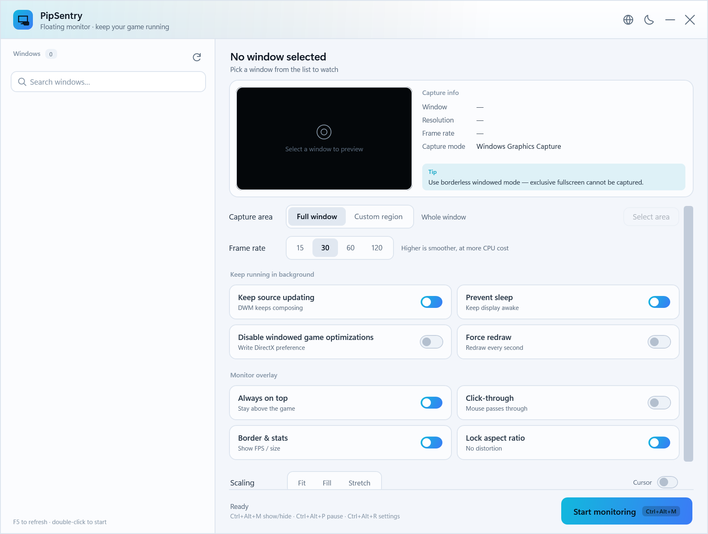
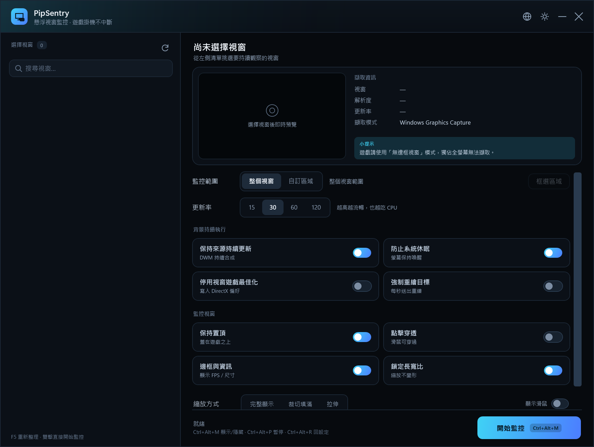

# PipSentry — 懸浮視窗監控（Windows）

> 遊戲掛機時，用一個小小的置頂視窗盯著背景視窗的即時畫面。
> 不必切回遊戲，也能看到進度；需要時再切回去。

| 深色（English） | 淺色（English） |
| --- | --- |
|  |  |

| 深色（繁體中文） |
| --- |
|  |

> 截圖為 `PipSentry.exe --render <png> --lang <culture> --theme <Dark|Light>` 的離屏渲染輸出，
> 不含任何使用者視窗內容。


## 特色

- **視窗／螢幕擷取**：使用 Windows Graphics Capture（與 OBS 相同的底層 API），可擷取被其他視窗遮住的背景視窗。
- **區域監控**：只框選畫面中真正要看的一小塊（例如血條、進度條、倒數計時），CPU／GPU 成本更低。
- **懸浮監控視窗**：無邊框、置頂、可拖曳縮放、鎖定長寬比、可調不透明度，並支援點擊穿透。
- **貼齊與尺寸預設**：拖曳到螢幕邊緣會自動吸附；右鍵可一鍵貼齊四角／置中、切換 100% / 50% / 25% / 鋪滿螢幕。
- **區域跟著解析度換算**：記住框選區域與當時的來源尺寸，遊戲換解析度後會自動等比換算，不必重新框選。
- **滑鼠指標**：可選擇在監控畫面中顯示來源視窗的游標（預設關閉）。
- **背景持續更新**：擷取工作階段會讓 DWM 持續合成來源視窗，降低遊戲轉背景後被降頻、停止更新的機率；另可防止系統／螢幕休眠、關閉 Windows 的「視窗化遊戲最佳化」。
- **鍵盤快捷鍵**：隨時顯示／隱藏、暫停、截圖、回到設定。
- **深色／淺色主題**：右上角一鍵切換，切換時整個視窗以 280ms 交叉淡入（不是硬切），設定會記住；監控視窗永遠維持深色，避免淺色邊框干擾遊戲畫面。
- **多語系（i18n）**：繁體中文 / 简体中文 / English，右上角地球按鈕即時切換、即時套用；首次啟動依系統語言自動選擇，選擇會寫入設定。字串集中於 `src/PipSentry/Localization/Lang.*.xaml`，新增語言只需複製一份並翻譯。
- **高 DPI 原生支援**：Per-Monitor V2，在 4K 150% / 200% 縮放下仍然清晰。
- **兩種發佈形式**：免安裝單檔 exe，以及標準 MSI 安裝檔（含開始功能表／桌面捷徑、解除安裝項目）。

## 系統需求

| 項目 | 需求 |
| --- | --- |
| 作業系統 | Windows 10 1903（含）以上、Windows 11（x64） |
| 執行階段 | 免安裝版與 MSI 版皆為 **self-contained**，不需要安裝 .NET |
| 顯示 | 需要 DWM 桌面合成（Windows 預設開啟） |

## 使用方式

1. 開啟 `PipSentry.exe`。
2. 在左側清單選擇要監控的視窗（包含「螢幕 1／2」可整個桌面擷取）。
3. 右側會即時預覽。需要局部監控時：
   - 監控範圍切到「自訂區域」→ 按「框選區域」→ 在覆蓋畫面上拖曳出範圍 → Enter 或按「套用」。
4. 選擇更新率（15 / 30 / 60 / 120 FPS）、縮放方式與視窗行為。
5. 按「開始監控」。主視窗隱藏，出現懸浮監控視窗。
6. 滑鼠移到監控視窗上會出現工具列：拖曳、暫停、重新框選、截圖、置頂、回設定、關閉。

### 快捷鍵

| 快捷鍵 | 功能 |
| --- | --- |
| `Ctrl+Alt+M` | 顯示／隱藏監控視窗（回到設定畫面） |
| `Ctrl+Alt+P` | 暫停／繼續擷取 |
| `Ctrl+Alt+S` | 儲存目前畫面到「圖片\PipSentry」 |
| `Ctrl+Alt+R` | 回到設定畫面 |
| `Ctrl+Alt+T` | 切換點擊穿透 |
| `F5` | 重新整理視窗清單（設定畫面） |

設定會自動儲存在 `%LOCALAPPDATA%\PipSentry\settings.json`，下次開啟會還原。

## 關於「背景不中斷」

程式提供四個層級的輔助（可在「背景持續執行」區塊切換）：

1. **保持來源持續更新** — 只要監控工作階段存在，DWM 就會持續合成來源視窗，這是避免背景遊戲被系統判定為「不需繪製」的主要手段。
2. **防止系統休眠** — 以 `SetThreadExecutionState` 讓系統與螢幕保持喚醒。
3. **停用視窗遊戲最佳化** — 對目標執行檔寫入
   `HKCU\Software\Microsoft\DirectX\UserGpuPreferences`：
   `GpuPreference=2;SwapEffectUpgradeEnable=0;`，關閉 Windows 11 的視窗化遊戲最佳化與省電行為（**需重新啟動遊戲**）。
4. **強制重繪目標** — 每秒送出一次 `RedrawWindow`，對傳統 GDI 視窗有效。

### 已知限制

- **獨佔全螢幕（Exclusive Fullscreen）無法擷取**：請把遊戲改成「無邊框視窗 / 視窗化」。
- **最小化的視窗無法擷取**：Windows 會停止合成最小化視窗；請讓視窗留在背景但不要最小化。
- 少數使用獨立繪製介面的程式（例如部分 Android 模擬器）可能出現黑畫面；此為該程式自行繪製到子視窗所致。
- 擷取需要管理員權限的視窗時，請以相同權限啟動 PipSentry。
- 監控「整個螢幕」時，若監控視窗也在同一螢幕上，會看到鏡像遞迴（正常現象）。

## 與其他開源方案的差異

| 專案 | 定位 | 與 PipSentry 的差異 |
| --- | --- | --- |
| [OnTopReplica](https://github.com/LorenzCK/OnTopReplica) | 最接近的專案：把任一視窗複製成置頂小窗，支援區域、透明度、點擊穿透 | 以 DWM Thumbnail 為主、WinForms + .NET Framework、Vista–Win10 世代；沒有「背景續行」相關設定、沒有深色 UI、沒有 MSI／單檔 exe |
| [WindowTop](https://github.com/WindowTop/WindowTop-App) | 商業化工具：置頂、PiP、透明度、夜間模式 | 功能面重疊，但非以「掛機監控」為核心，也沒有擷取工作階段維持合成的說明與 DirectX 偏好調整 |
| [OBS Studio](https://github.com/obsproject/obs-studio) | 直播／錄影，內含 `libobs-winrt` 視窗擷取 | 可做到「監看」，但設定重、不適合常駐小視窗；PipSentry 的擷取層與 OBS 用同一組 Windows.Graphics.Capture API |
| [ScreenCapture.NET / WgcSharp](https://www.nuget.org/packages/WgcSharp) | 擷取函式庫 | 只是底層元件，沒有 UI、沒有安裝檔 |

PipSentry 的差異化在於：**以「掛機時盯著背景遊戲的一小塊畫面」為單一目的**，把擷取、區域框選、置頂小窗、背景續行選項與兩種派送格式整合成一個小工具。

### 關於「借鑒」

- **OnTopReplica** 採用 **MS-RL**（互相授權條款）、**WindowTop** 為專有授權（保留所有權利）、**OBS Studio** 為 **GPL-2.0**。
  因此本專案**沒有複製任何一行它們的程式碼**，只參考「功能設計與 API 用法」：
  - OnTopReplica：區域框選的互動流程、貼齊角落與尺寸預設、以像素比例保存區域的想法。
  - WindowTop：右鍵選單式的功能切換、淺／深色主題的配置方式。
  - OBS：以 `Windows.Graphics.Capture` 做視窗擷取、`IsCursorCaptureEnabled` / `IsBorderRequired` 的處理方式。
- 這些都是公開的 Windows API 行為，重新實作不涉及授權傳染。若日後要直接取用它們的程式碼，請先確認授權（MS-RL 具傳染性、GPL-2.0 會要求本專案同樣以 GPL 釋出）。

## 專案結構

```
src/PipSentry/
  App.xaml(.cs)                 應用程式進入點、全域快捷鍵、系統匣、監控生命週期
  Views/
    ShellWindow.xaml(.cs)       設定主視窗（視窗清單、即時預覽、選項）
    MonitorWindow.xaml(.cs)     懸浮監控視窗（無邊框、置頂、工具列、長寬比鎖定）
    RegionSelectorWindow.*      區域框選覆蓋層
  Capture/
    WgcInterop.cs               Windows.Graphics.Capture + D3D11 原生互通
    WgcCaptureEngine.cs         WGC 擷取引擎（區域裁切、FPS 節流、尺寸變更重建）
    GdiCaptureEngine.cs         GDI / PrintWindow 相容後備引擎
    CaptureController.cs        擷取狀態機、UI 執行緒派送、單張快照
  Interop/                      Win32 / DWM 宣告、視窗列舉與圖示
  Services/                     設定、系統匣、防休眠、開機偏好
  Themes/                       設計權杖（色彩、字體）與控制項樣式
packaging/PipSentry.wxs         WiX v5 安裝專案（MSI）
tools/                          圖示產生、視窗截圖小工具（開發用）
dist/                           發佈輸出
```

## 建置

需要 .NET 8 SDK 與 WiX 5（僅打包 MSI 時）。

```powershell
# 1) 免安裝單檔 exe
dotnet publish src/PipSentry -c Release -r win-x64 --self-contained true `
  -p:PublishSingleFile=true -p:IncludeNativeLibrariesForSelfExtract=true `
  -p:EnableCompressionInSingleFile=true -o dist/PipSentry-portable

# 2) MSI 安裝檔
dotnet tool install --tool-path .tools/wix wix --version "5.*"
.tools/wix/wix.exe extension add WixToolset.UI.wixext
cd packaging
../.tools/wix/wix.exe build -arch x64 -ext WixToolset.UI.wixext PipSentry.wxs `
  -o ../dist/PipSentry-1.1.1-x64.msi
```

或直接執行 `./build.ps1`（一次產生兩種格式）。

## 授權

本專案原始碼可自由用於個人與商業用途；使用時請自行確認被擷取內容的權利歸屬。