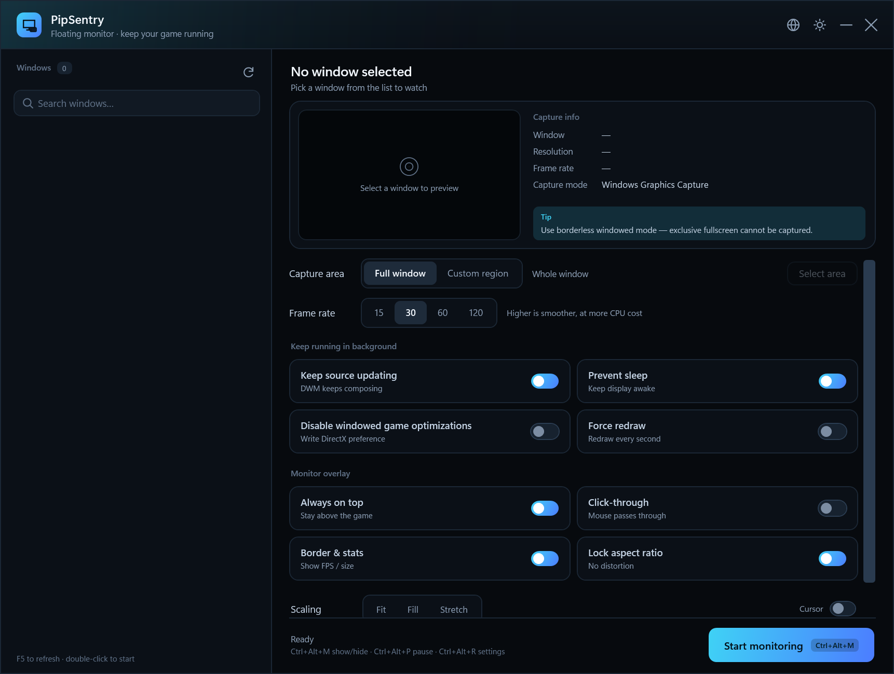

# PipSentry

Windows 視窗監控小工具。把某個視窗（或螢幕）的一塊畫面釘在最上層，掛機時不用切回去看進度。



## 能做什麼

- 抓背景視窗，被其他視窗蓋住也抓得到（Windows Graphics Capture）
- 只框畫面的一小塊，之後換解析度會自動換算
- 懸浮窗無邊框、置頂，可調透明度、滑鼠穿透、貼齊角落、尺寸預設
- 深色／淺色，繁中／簡中／英文
- 免安裝單檔 exe，或 MSI 安裝

## 需求

Windows 10 1903 以上、Windows 11，x64。不用另外裝 .NET。

## 用法

1. 開程式，左邊清單選要看的視窗
2. 只看局部就切「自訂區域」，按「框選區域」，拖一個範圍後按 Enter
3. 按「開始監控」

滑鼠移到懸浮窗上會出現工具列，右鍵有貼齊、大小、穿透、截圖。

## 快捷鍵

| 按鍵 | 作用 |
| --- | --- |
| `Ctrl+Alt+M` | 顯示／隱藏監控窗 |
| `Ctrl+Alt+P` | 暫停／繼續 |
| `Ctrl+Alt+S` | 截圖（存到「圖片\PipSentry」） |
| `Ctrl+Alt+R` | 回設定 |
| `Ctrl+Alt+T` | 點擊穿透 |
| `F5` | 重新整理視窗清單 |

設定在 `%LOCALAPPDATA%\PipSentry\settings.json`。

## 限制

- 獨佔全螢幕抓不到，請用無邊框視窗
- 最小化的視窗抓不到
- 有些程式自己畫在子視窗上（例如部分 Android 模擬器），會是黑畫面
- 抓需要管理員權限的視窗時，PipSentry 也要用同樣權限開

## 背景不要停

掛機時遊戲切到背景常被降頻或停止更新，程式提供四個開關：

- 保持來源持續更新：監控期間讓 DWM 一直合成來源視窗
- 防止系統休眠：`SetThreadExecutionState`
- 停用視窗遊戲最佳化：對目標 exe 寫 `SwapEffectUpgradeEnable=0`，改完要重開遊戲
- 強制重繪目標：每秒送一次 `RedrawWindow`，對老式視窗有用

## 建置

```powershell
./build.ps1
```

需要 .NET 8 SDK；打包 MSI 另外需要 WiX 5。輸出在 `dist/`。

## 授權

MIT。設計上參考過 OnTopReplica、WindowTop、OBS 的做法，沒有使用它們的程式碼。
